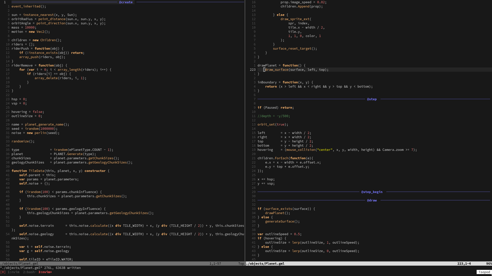
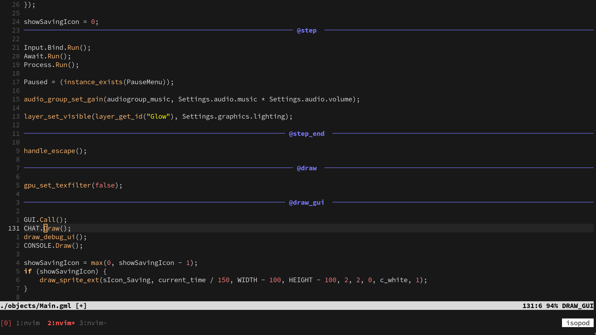

# GLIM
glim is a tool for converting GameMaker projects into a more reasonable Vim friendly format.

---

Examples




## Quickstart

Under your GameMaker project directory, start using glim like this.

```sh
# to initialize glim filesystem in '.gm/'.
$ glim init

# to set project target and automatically convert GameMaker objects and scripts into '.gm/project/'.
$ glim set ./

# to convert the files back to GameMaker filesystem.
$ glim sync

# to reload objects and scripts that are not in '.gm/project/'.
# `--rebase` flag to completely erase and replace everything
$ glim reload

# other
$ glim remove  # deletes '.gm/' filesystem
$ glim clean   # deletes leftovers in '.gm/.diffs/'
$ glim version # outputs version 
```

---

## Neovim Plugin
I made a custom config for gml files in nvim, it is rushed and not good, 
but it shows the separated Events in a nice blue color, 
it has syntax highlighting similar to the GameMaker theme, 
it also shows which Event you are editing in the statusline.

* [my nvim GML config](https://github.com/amdreiso/dotfiles/blob/main/nvim/lua/config/gml.lua) *(vibe coded to some extent :P)*

---
## How it works

### Converting

Using `obj_player` as an example, GameMaker objects are stored in a folder with the Object's name, with scattered files for each Event, and index file with the Object's name ending with .yy

```sh
└─ obj_player
   ├─ Create_0.gml
   ├─ Step_0.gml
   ├─ Step_1.gml
   ├─ Draw_0.gml
   └─ obj_player.yy
```

Glim converts the `obj_player` directory into a file called `obj_player.gml` like this:

```
@create
// code

@step
// code

@step_begin
// code

@draw
// code
// and so on...
```
and copies it into `.gm/project/objects/`

---

As to Scripts, they are structured like this
```sh
└─ script_name
   └─ script_name.gml
```

There isn't much converting to be done except copying the `.gml` file into `.gm/project/scripts/` folder, while also converting any CRLF *(windows new lines)* into LF *(normal new lines)*

---
The converted results will look like this
```sh
.gm
└─ project
   ├─ objects
   │  ├─ obj_example_0.gml
   │  ├─ obj_example_1.gml
   │  └─ obj_example_2.gml
   └─ scripts 
      ├─ script_name_0.gml
      ├─ script_name_1.gml
      └─ script_name_2.gml
```
---
### Syncing
Syncing basically means: taking every generated file in `.gm/project/objects/ & scripts/` 
and converting them back to the original GameMaker project. Reversing the whole process of conversion while 
also generating a new `index.yy` file with updated Events.

Meaning that, if an Object had only a Create Event, and you added **@step**, **@draw**, etc. in your converted Object 
file, it is automatically going to add that Event in the `index.yy` file, otherwise it would be unbeknownst 
to GameMaker that a new Event was created at all.

